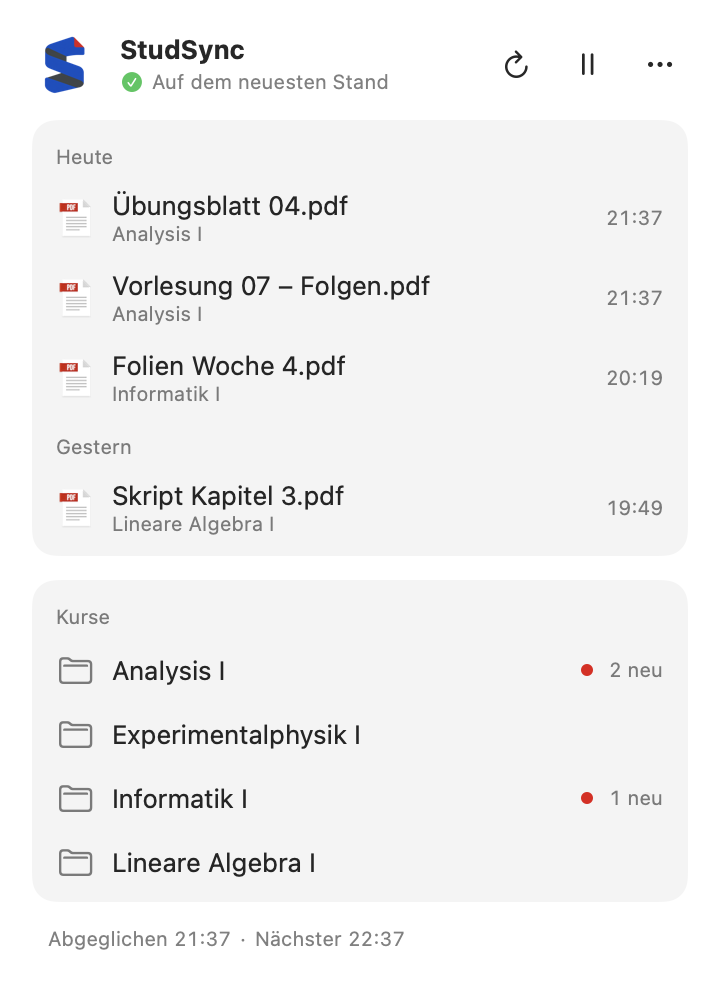
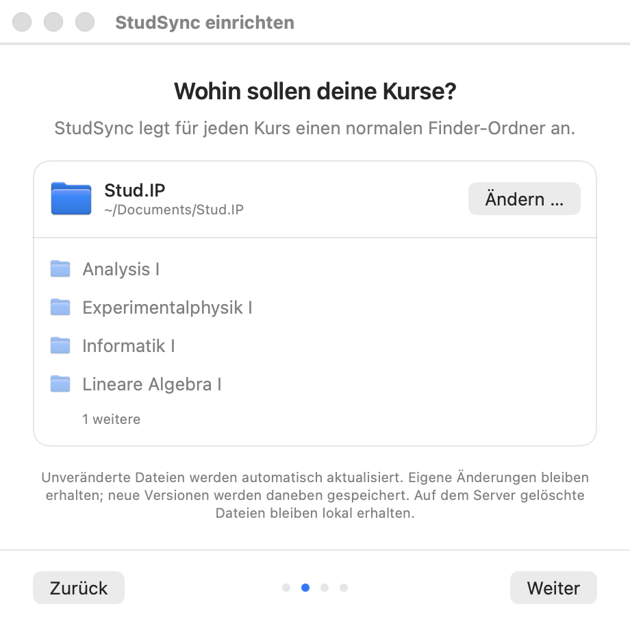
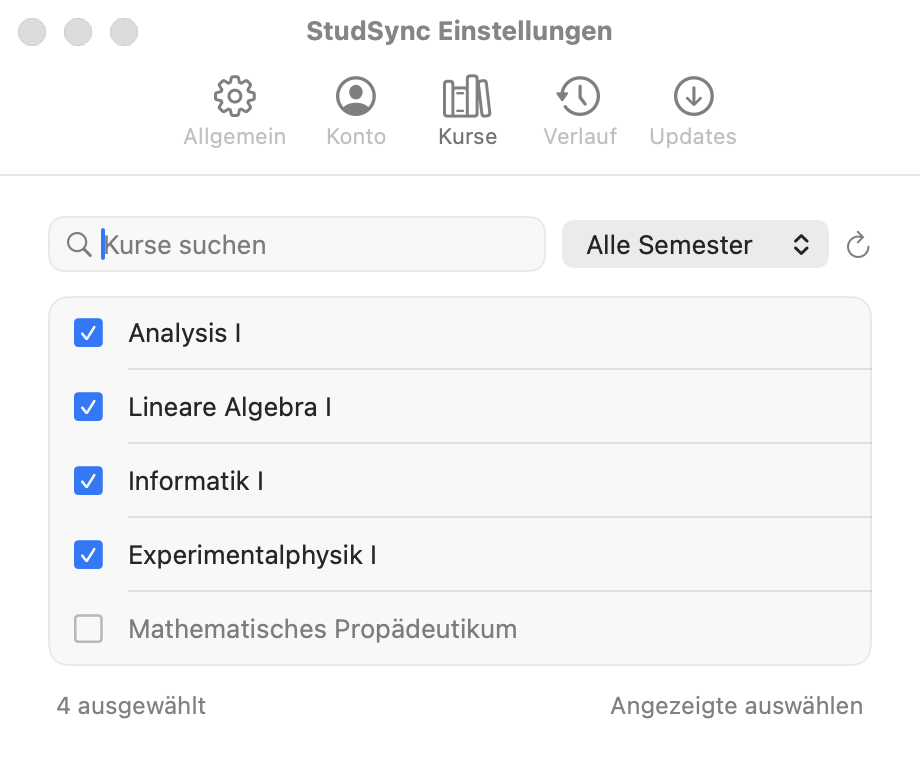

# StudSync

[English](README.md) · **Deutsch**

StudSync holt deine Stud.IP-Kursdateien der Universität Göttingen in ganz normale Finder-Ordner auf deinem Mac. Die App sitzt in der Menüleiste, lädt neue Folien und Übungsblätter im Hintergrund und zeigt dir, was neu ist. Du arbeitest mit den Dateien in Finder, Vorschau oder jeder anderen App, auch offline.

## Voraussetzungen

- Ein Mac mit Apple Silicon (M1 oder neuer) und macOS 15 oder neuer
- Ein Account der Universität Göttingen mit Zugang zu Stud.IP

## Installation

1. Lade `StudSync-…-arm64.zip` aus dem [neuesten Release](https://github.com/gnagster/StudSync/releases/latest). Die „Source code“-Archive sind nicht die App.
2. Entpacke die Datei und ziehe `StudSync.app` in deinen Programme-Ordner.
3. Öffne StudSync. Die App ist nicht von Apple notarisiert, deshalb blockiert macOS eventuell den ersten Start. Öffne dann **Systemeinstellungen → Datenschutz & Sicherheit** und klicke bei StudSync auf **Dennoch öffnen**. Mach das nur bei einem Download, dem du vertraust, und lass Gatekeeper eingeschaltet.

StudSync aktualisiert sich selbst. Die App sucht nach neuen Versionen und installiert nur Updates mit der Signatur des Projekts. Du kannst auch im ⋯-Menü des Panels **Nach Updates suchen …** wählen.

## Einrichtung in vier Schritten

Beim ersten Start führt dich ein kurzer Assistent durch die Einrichtung:

1. **Anmelden** mit deinem Uni-Benutzernamen (ohne E-Mail-Endung) und Passwort. Alternativ geht auch der Web-Login der Universität.
2. **Ordner wählen.** StudSync schlägt `~/Documents/Stud.IP` vor und legt darin für jeden Kurs einen Unterordner an.
3. **Kurse auswählen.** Die Kurse des aktuellen Semesters sind schon ausgewählt. Über die Suche oder ein anderes Semester fügst du weitere hinzu.
4. **Synchronisieren.** StudSync lädt deine Dateien und zeigt die angelegten Kursordner.

Den Assistenten kannst du später erneut über **Onboarding starten** im ⋯-Menü des Panels durchlaufen.

## Im Alltag

Klicke auf das StudSync-Symbol in der Menüleiste, um das Panel zu öffnen:

- **Neue Dateien** stehen nach Tagen sortiert mit ihrem Kurs darunter. Ein Klick zeigt die Datei im Finder.
- **Kurse** öffnet einen Kursordner. Ein roter Punkt markiert Kurse mit neuen Dateien von heute.
- **⟳** synchronisiert sofort (⌘R), **❙❙** pausiert, und unter **⋯** findest du Im Finder öffnen, Einstellungen, Onboarding starten, Updates und Beenden.

Standardmäßig synchronisiert StudSync stündlich. Du kannst auf alle 15 Minuten, alle vier Stunden oder nur manuell umstellen. Kommen neue Dateien an, sagt dir eine Mitteilung, zu welchem Kurs sie gehören; ein Klick darauf zeigt die Dateien im Finder. Wenn du das Panel schließt, läuft StudSync weiter. Zum Beenden wählst du **Beenden**.

## Einstellungen

Die Einstellungen öffnest du über das ⋯-Menü oder mit ⌘, bei geöffnetem Panel.

- **Allgemein:** Sync-Ordner, Intervall, Start bei Anmeldung und Mitteilungen
- **Konto:** wer angemeldet ist, und neu anmelden
- **Kurse:** welche Kurse synchronisiert werden, aus jedem Semester
- **Verlauf:** Dateien, die die letzten Synchronisierungen geändert haben
- **Updates:** automatische Suche und Download von Updates

## Deine Dateien sind sicher

- Dateien, die du nicht verändert hast, werden ersetzt, sobald es auf Stud.IP eine neue Version gibt.
- Dateien, die du bearbeitet hast, werden nie überschrieben. Die neue Version von Stud.IP landet daneben.
- Wird eine Datei auf Stud.IP gelöscht, bleibt sie auf deinem Mac.
- Dateien, die schon im Ordner lagen, bleiben erhalten, außer sie sind identisch mit der Version auf dem Server.
- Namen bleiben lesbar, zum Beispiel `Analysis I/Folien/Vorlesung 07.pdf`. Hätten zwei Dateien denselben Namen, bekommt eine davon eine Nummer wie `(2)`.

## Datenschutz

Dein Passwort liegt im macOS-Schlüsselbund. macOS fragt eventuell einmal, ob StudSync es lesen darf. StudSync spricht nur mit dem Stud.IP-Server der Universität und für Updates mit GitHub. Einstellungen und Sync-Verlauf liegen auf deinem Mac unter `~/Library/Application Support/StudSync/`.

## Hilfe bei Problemen

- **Offline passiert nichts.** StudSync versucht es automatisch erneut, sobald die Verbindung zurück ist, außer die Synchronisierung ist pausiert oder auf manuell gestellt.
- **„Bitte erneut anmelden.“** Die Universität hat die gespeicherte Sitzung nicht akzeptiert. Öffne Einstellungen → Konto und melde dich neu an.
- **Ein Kurs fehlt.** Öffne Einstellungen → Kurse, wähle das passende Semester und klicke auf ⟳ (Kurse aktualisieren).
- **Start bei Anmeldung funktioniert nicht.** Lass `StudSync.app` in dem Programme-Ordner, in dem du sie installiert hast.

StudSync hält deinen Mac nicht wach; die App synchronisiert, sobald der Mac das nächste Mal wach und online ist.

## Mitentwickeln

Du möchtest StudSync selbst bauen oder mitentwickeln? Alles Nötige steht in [CONTRIBUTING.md](CONTRIBUTING.md) (auf Englisch).
