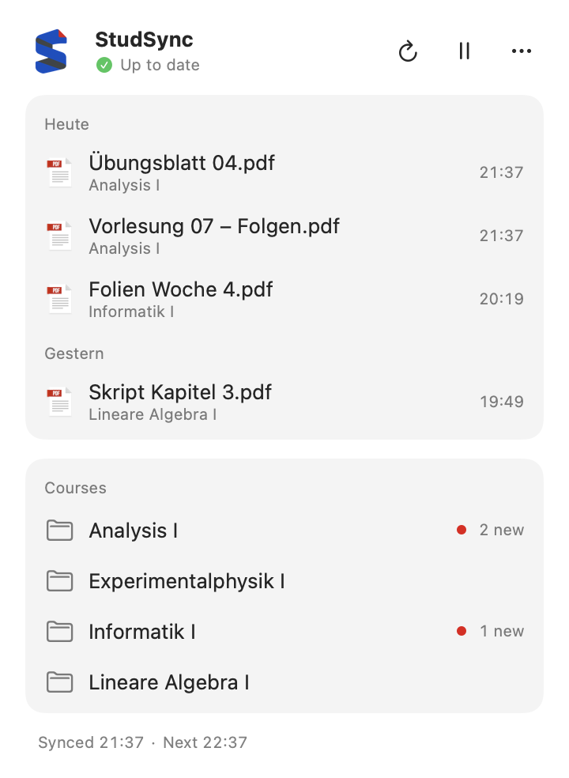
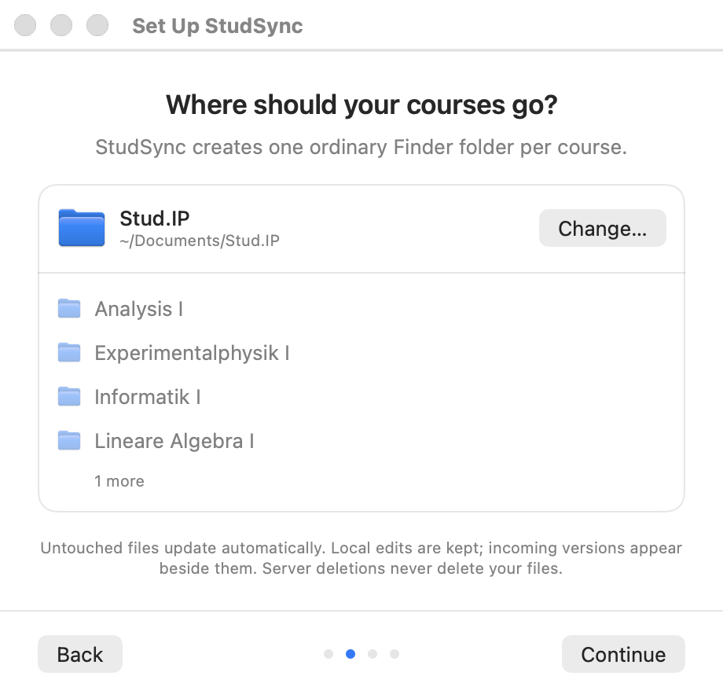
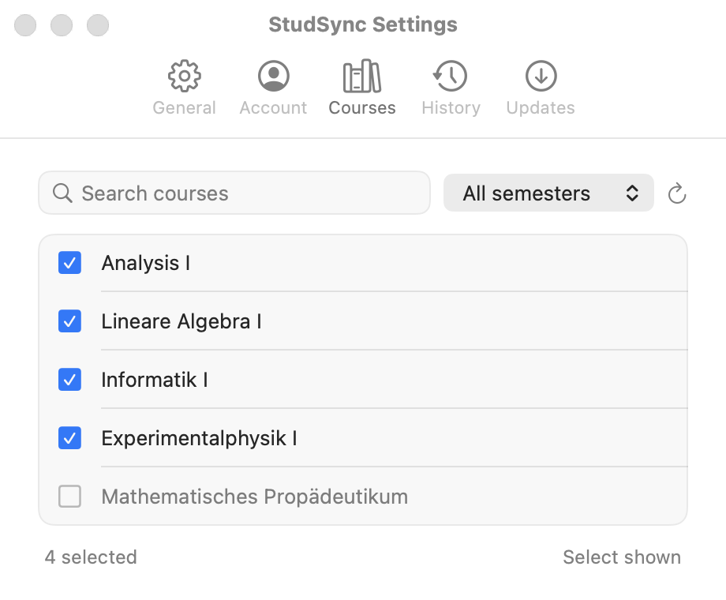

# StudSync

**English** · [Deutsch](README.de.md)

StudSync puts your Stud.IP course files from Universität Göttingen into ordinary Finder folders on your Mac. It sits in the menu bar, downloads new slides and exercise sheets in the background and tells you what arrived. You work with the files in Finder, Preview or any other app, even offline.

## What you need

- A Mac with Apple Silicon (M1 or newer) running macOS 15 or later
- A Universität Göttingen account with access to Stud.IP

## Install

1. Download `StudSync-…-arm64.zip` from the [latest release](https://github.com/gnagster/StudSync/releases/latest). The “Source code” archives are not the app.
2. Unzip it and move `StudSync.app` into your Applications folder.
3. Open StudSync. The app is not notarized by Apple, so macOS may block the first launch. In that case open **System Settings → Privacy & Security** and click **Open Anyway** for StudSync. Only do this for a download you trust, and leave Gatekeeper switched on.

StudSync updates itself. It checks for new versions and only installs updates carrying the project’s signature. You can also choose **Check for Updates…** from the panel’s ⋯ menu.

## Set up in four steps

On first launch a short assistant walks you through setup:

1. **Sign in** with your university username (without the email suffix) and password. You can also use the university web login.
2. **Choose a folder.** StudSync suggests `~/Documents/Stud.IP` and creates one subfolder per course in it.
3. **Pick your courses.** Courses from the current semester are already selected. Search or switch semesters to add more.
4. **Sync.** StudSync downloads your files and shows the course folders it created.

To run the assistant again later, choose **Start onboarding** from the panel’s ⋯ menu.

## Everyday use

Click the StudSync icon in the menu bar to open the panel:

- **New files** are listed by day with their course. Click one to show it in Finder.
- **Courses** opens a course folder. A red dot marks courses with new files today.
- **⟳** syncs now (⌘R), **❙❙** pauses syncing and **⋯** holds Open in Finder, Settings, Start onboarding, updates and Quit.

StudSync syncs every hour by default. You can switch to every 15 minutes, every four hours or manual only. When new files arrive, a notification tells you which course they belong to; click it to see the files in Finder. Closing the panel keeps StudSync running. Choose **Quit** to stop it.

## Settings

Open Settings from the ⋯ menu or with ⌘, while the panel is open.

- **General:** sync folder, sync interval, start at login and notifications
- **Account:** who is signed in, and signing in again
- **Courses:** choose which courses to sync, from any semester
- **History:** files changed by recent syncs
- **Updates:** automatic update checks and downloads

## Your files are safe

- Files you have not changed are replaced when a new version appears on Stud.IP.
- Files you have edited are never overwritten. The new version from Stud.IP is saved next to yours.
- A file deleted on Stud.IP stays on your Mac.
- Files that were already in the folder are kept unless they match the server’s copy.
- Names stay readable, for example `Analysis I/Folien/Vorlesung 07.pdf`. If two files would get the same name, one gets a number such as `(2)`.

## Privacy

Your password is stored in the macOS Keychain. macOS may ask once whether StudSync may read it. StudSync only talks to the university’s Stud.IP server and to GitHub for updates. Settings and sync history are stored on your Mac in `~/Library/Application Support/StudSync/`.

## Troubleshooting

- **Nothing syncs while offline.** StudSync retries automatically when the connection returns, unless syncing is paused or set to manual.
- **“Please sign in again.”** The university did not accept the saved session. Open Settings → Account and sign in again.
- **A course is missing.** Open Settings → Courses, choose the right semester and click ⟳ (Refresh courses).
- **Start at login does not work.** If macOS asks for approval, click **Open Login Items…** in Settings → General and allow StudSync. Keep `StudSync.app` in the Applications folder where you installed it.

StudSync does not keep your Mac awake; it syncs the next time your Mac is awake and online.

## Contributing

Want to build StudSync yourself or help develop it? See [CONTRIBUTING.md](CONTRIBUTING.md).
